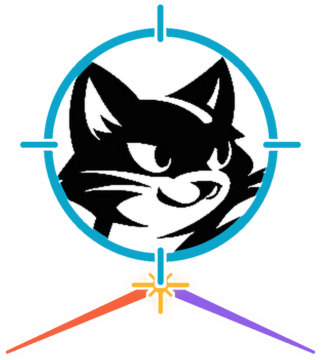
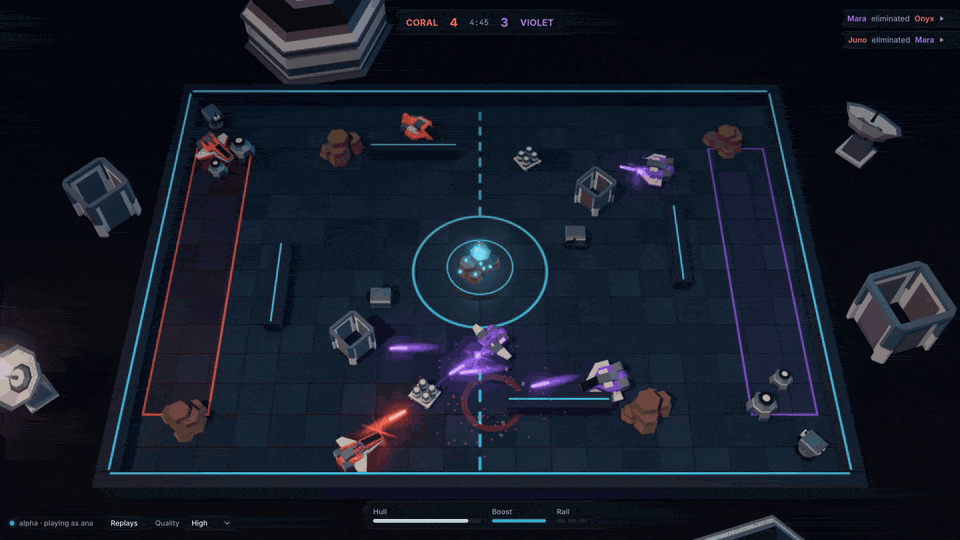
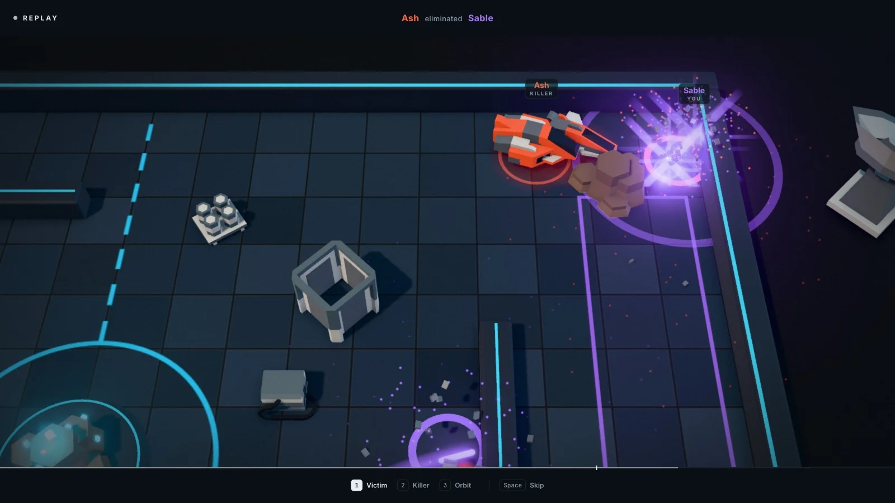
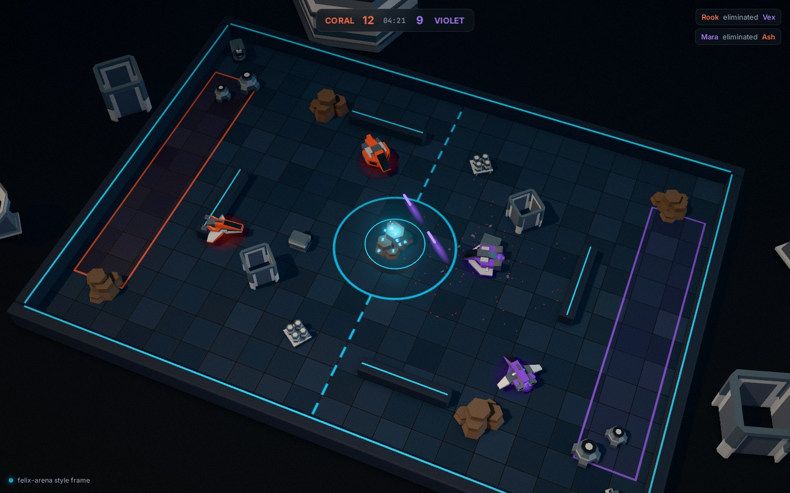

<p align="center">
  
</p>

<h1 align="center">Felix Arena</h1>

<p align="center">
  A browser arena game built on <a href="https://github.com/GetFelix/felix">Felix</a>.
</p>

<p align="center">
  <a href="LICENSE"></a>
</p>

[](docs/screenshots/arena.mp4)

<sub>A live four-a-side match on the development stack, played in Edge: one
player in the browser and seven bots through the gateway. When the browser's
craft is destroyed, the kill cam replays the seconds before it, read back from
the match's tick stream in Felix, and ends on the explosion and who destroyed
whom. Full size: [arena.mp4](docs/screenshots/arena.mp4).</sub>



Felix Arena is a team deathmatch for up to eight players, Coral against
Violet, flying low-poly hover-craft in a walled arena seen from a top-down
camera. It is playable: a match runs through Felix from warmup to results,
with the simulation deciding every hit. When you are destroyed, the kill cam
replays the last seconds from the match's log, from your view, your killer's,
or a camera that orbits the fight. Still to come are the lobby and per-arena
sign-in. It is meant for people who want a small multiplayer game they can
host themselves, and for game developers evaluating Felix as the backend for
live play, spectating and replays.

Each arena's simulation commits every tick to a durable Felix
stream as an
[atomic commit](https://github.com/GetFelix/felix/blob/main/docs/atomic-commit.md),
and every 30th tick also updates a stream state key that points at it as a
keyframe. Players and spectators join by reading that key and subscribing from
its offset, and the kill cam is a read of the same stream from an offset named
in the kill event. Inputs go on an in-memory stream with
[drop-new delivery](https://github.com/GetFelix/felix/blob/main/docs/semantics.md#delivery-to-subscribers),
presence and the lobby are
[cache](https://github.com/GetFelix/felix/blob/main/docs/cache-on-log.md) keys with
a TTL, and who may play or watch is a Felix RBAC role, enforced through tokens
the control plane
[narrows](https://github.com/GetFelix/felix/blob/main/docs/auth.md#control-plane-token-exchange-flow)
to one arena. Tick streams are to be replicated across three brokers, so a
match can continue after its broker
[fails](https://github.com/GetFelix/felix/blob/main/docs/semantics.md#failover).



## Features

- **A full match through Felix.** Warmup, a timed team deathmatch to a kill
  limit, results and the next match, with respawns, the rail pickup, the score,
  clock, kill feed and scoreboard. The simulation in `sim/` is the only
  authority and commits each tick to a durable Felix stream at 30 Hz; inputs
  travel on an in-memory stream, stamped with the sender by the gateway.
- **Rules written once.** Movement, collision, bolts, damage, spawns and the
  tick encoding live in `core/`, linked by the simulation and compiled to
  WebAssembly for the browser, which predicts your own craft and interpolates
  the others.
- **Fair respawns.** A destroyed craft comes back at the point on its side
  farthest from the enemy and out of their sight, behind a two-second shield
  that ends when it fires.
- **Keyframes.** Every 30th tick's commit also writes the `keyframe` state key,
  so a player or spectator joins a match in progress from the newest keyframe
  and catches up without drawing.
- **The kill cam.** Each kill event names the offset of the tick three seconds
  earlier. The victim's page reads that range of the log and plays the last two
  seconds of it, with slow motion before the killing shot, then the explosion
  and who destroyed whom, while the live match carries on underneath. Every kill in the feed can be replayed, from this match or an
  earlier one, until retention trims it.
- **Offline play.** `play.html?offline` runs `core` in the page against three
  bots, with no servers.
- **Quality tiers.** High, Medium and Low, chosen from the first seconds of
  frame times or picked in the HUD.
- **Every hop timed.** `ticks.html` shows the p50 and p99 of each leg from the
  simulation's commit to the page.
- **Releases.** Each release carries the built web client, so it can be played
  with a static file server and no Node.

The style frame, `prototype/style-frame.html`, is the reference for the look.
`web/` is that page rebuilt as the game's renderer: TypeScript and Three.js,
built with Vite, with every model restyled through `web/src/models.ts`, every
colour from `web/src/palette.ts`, and the walls, cover and prop positions taken
from the collision layout in `core/`. CI screenshots the app and the style
frame at the same frozen moment in headless Chromium and fails when they
differ.

The simulation waits for each commit before the next, and every five seconds
logs, per arena, the ticks committed, the rate and the commit latency (p50,
p99, max). Its settings are the `SIM_*` variables
documented in [sim/src/config.rs](sim/src/config.rs).

## Quick start

The style frame loads Three.js from jsDelivr, so it needs a network connection
and any static file server. Serve the `prototype` folder and open it:

```bash
cd prototype && python3 -m http.server 8000
# open http://localhost:8000/style-frame.html
```

Drag to orbit the camera. Add `?t=1.2` to the URL to freeze the action at that
moment.

The app renders the same moment, and takes the same `?t=`:

```bash
cd web && npm install && npm run core && npm run dev
# open http://localhost:5173/?t=1.2
```

`npm run frame -- <app url> <style frame url> <out dir>` screenshots both at
1920x1080 and writes `style-frame.png`, `app.png`, `diff.png` and `diff.json`;
the `style frame` CI job runs it and uploads them as the `frames` artifact.

## Run a release

Each release on GitHub carries the built web client as
`felix-arena-web-<version>.tar.gz`, so playing it needs no Node or npm, only a
static file server. With no tag, `gh release download` fetches the newest
release, so run this in an empty directory:

```bash
gh release download -R GetFelix/felix-arena -p 'felix-arena-web-*'
shasum -a 256 -c felix-arena-web-*.tar.gz.sha256
tar -xzf felix-arena-web-*.tar.gz
cd felix-arena-web-*/ && python3 -m http.server 5173
# open http://localhost:5173/play.html?offline
```

`play.html?offline` runs the game in the page against three bots;
`&bots=easy|normal|hard` and `&botcount=1..3` set how many and how well they
play. With the
development stack below running, `play.html?arena=alpha&as=ana` plays through
Felix instead.

## Development stack

`dev/up.sh` starts Felix (a control plane and one broker), a stand-in identity
provider, felix-gateway on `ws://127.0.0.1:8787` and the sim, with two arenas,
`alpha` and `bravo`, from Docker or Podman (`CONTAINER_ENGINE` picks one). The
broker batches deliveries with a short delay and keeps the default `drop_new`
subscriber queues. Watch the sim's tick rate and commit latency with:

```bash
dev/up.sh
docker compose -f dev/compose.yml logs -f sim   # or podman compose
dev/down.sh                                     # stop it and delete its data
```

`dev/up.sh` waits on the broker through host port 8080; set
`ARENA_BROKER_PORT` to another port if something on the host already uses it.

The ticks page follows one arena's tick stream through the gateway, showing
each tick's offset and number as it arrives, and the p50 and p99 of each leg
of its trip from the sim:

```bash
cd web && npm install && npm run core && npm run dev
# open http://localhost:5173/ticks.html?arena=alpha
```

`npm run core` builds `core/` to WebAssembly into `web/src/core/`, which the
page decodes ticks with. It needs the `wasm32-unknown-unknown` target, which
`rust-toolchain.toml` installs, and `wasm-bindgen-cli` 0.2.129
(`cargo install wasm-bindgen-cli --version 0.2.129`).

`?as=` picks the dev user to sign in as (default `cleo`, who may only watch).

The live game is `play.html`: `http://localhost:5173/play.html?arena=alpha&as=ana`
flies `ana`'s craft and `as=ben` in a second window flies the other. W, A, S
and D move your craft up, left, down and right on the screen, wherever it is in
the arena. The mouse aims: a reticle replaces the pointer over the game, and a
faint line runs from your craft's nose to it, at the height your bolts fly. The
left button fires and Space boosts. Your craft is predicted through `core` and
everyone else is interpolated from ticks. The quality tier (High, Medium or Low)
is chosen from the first seconds of frame times; the Quality setting on the HUD
or `&quality=high|medium|low|auto` overrides it. The page runs the
match loop the sim decides: warmup, play, results and the next match, with the
score, clock, kill feed and your hull, boost and rail on the HUD, and Tab for
the scoreboard. When you are destroyed the kill cam plays: 1, 2 and 3 switch
between your view, your killer's and an orbit, and Space or Escape skips it.
R opens the replays panel, where any kill in the feed, or from an earlier
match, can be replayed. `dev/compose.yml` lets `ana`, `ben`, `dan` and `eve` play.

`play.html?offline` needs no dev stack: core's world runs in the page as the
sim, with three bots, so the game can be seen and played anywhere. The
offline sim keeps no log, so its kill cam replays from the last 40 seconds the
page kept, and earlier matches cannot be replayed.
`&bots=easy|normal|hard` (normal by default) sets how well the bots aim, how
quickly they react, how they pace their fire and whether they chase across the
arena; `&botcount=1..3` (3 by default) sets how many. They steer through the
same input path as a player.
`&length=`, `&warmup=` and `&results=` shorten the match, in seconds.

`npm run smoke` checks the same path from Node: ticks arrive at 30 Hz, the
WebAssembly build decodes keyframes to the state hashes the sim logged, a
range read returns the same records while the live subscription keeps going,
and it
prints each leg's latency. It also drives two players, `ana` and `ben`, in
arena `bravo`: each moves only its own craft, a forged input naming the other
player is refused, and `cleo` cannot publish inputs. And it has `ana` fly
circles in arena `alpha` while `cleo` watches, then plays `cleo`'s ticks
through the interpolator with one in twenty thrown away, checking that the
craft moves smoothly. Finally, it checks that the `keyframe` state key's
version is the newest keyframe's offset, and that a subscription from that
offset starts at the keyframe.

CI's `join mid-match` job joins `cleo` to a match being played twenty times
from a cold browser. It gates the state read, first event and catch-up fold
at 500 ms p50, reports signing in and the first draw (on CI's software
renderer; real-GPU frame times come from the benchmark page), and checks that
its folded state matches the player's at every tick.

## Frame time

The target is 60 frames a second at 1080p on a laptop iGPU at High or Medium.
The benchmark plays a busy two-minute offline match at 1920x1080 and reports
the frame times and the tier it drew at:

```bash
cd web && npm install && npm run core && npm run build && npx vite preview
# open http://localhost:4173/play.html?offline&bench&quality=auto
# and again with &quality=high and &quality=medium
```

Run it in a normal (not headless) browser window, plugged in, with nothing else
busy. Frame intervals cannot be shorter than the display's refresh, so a
60 Hz display caps the result at 60 frames a second.

| Machine | GPU | Browser | Tier | Frames a second | Frame time p50 / p95 |
|---|---|---|---|---|---|
| _to be measured_ | | | | | |

## How it works

Three processes sit around Felix: the browser client, a stateless
gateway that bridges WebSocket to Felix's QUIC protocol, and a Rust simulation
that is the single authority for each arena, stepping it at 30 Hz. The client
and the simulation are this project's own. The gateway is
[felix-gateway](https://github.com/GetFelix/felix-gateway) 0.6.0, whose
`binary_events` feature carries the game's ticks as binary frames, whose
`state` feature reads the keyframe pointer, and whose `read` feature returns a
fixed range of the log for the kill cam beside the live subscription. The plan is to ship it in this project's own image, which
will also serve the web client. The game rules live in one Rust crate, linked by the simulation and
compiled to WebAssembly for the browser's prediction, so the two cannot
disagree about the rules.

| What | Felix primitive | Name |
|---|---|---|
| Ticks: the match | Durable stream, 1 shard, `Quorum`, 3 replicas | `arena.ticks.<arena>` |
| Latest keyframe | Stream state key on the tick stream | `keyframe` |
| Match start offsets | Stream state keys on the tick stream | `match/<n>` |
| Player inputs | Ephemeral stream | `arena.input.<arena>` |
| Who is connected | Cache keys with TTL | `arena.members.<arena>/<session>` |
| Simulation epoch | Counter | `arena.epoch.<arena>/sim` |
| Lobby: every arena's status | Cache keys with TTL | `arena.lobby/<arena>` |
| Who may play, who may watch | Felix RBAC roles | `role:arena-<arena>-play`, `role:arena-<arena>-watch` |

[docs/design.md](docs/design.md) has the full design, including the tick
format, joining mid-match, the kill cam, prediction and failure modes. Its
section
[How multiplayer games are normally built](docs/design.md#how-multiplayer-games-are-normally-built)
compares this with the usual way of building a session-based game.

## Status

The look is locked, the game is playable through Felix, a match can be joined
in progress, and the kill cam replays kills from the log (M0 to M2 and M4). M3
is done apart from the lobby and member list. The frame-time row for M0's 60 fps target
waits for a run on an Intel Iris Xe or Apple M1. Each milestone is a
[GitHub milestone](https://github.com/GetFelix/felix-arena/milestones) with an
issue per piece of work.

| M | Milestone | Status |
|---|---|---|
| [0](https://github.com/GetFelix/felix-arena/milestone/1) | The look, locked | Done |
| [1](https://github.com/GetFelix/felix-arena/milestone/2) | A browser reaches Felix | Done |
| [2](https://github.com/GetFelix/felix-arena/milestone/3) | One authority | Done |
| [3](https://github.com/GetFelix/felix-arena/milestone/4) | Join mid-match | In progress |
| [4](https://github.com/GetFelix/felix-arena/milestone/5) | The kill cam | Done |
| [5](https://github.com/GetFelix/felix-arena/milestone/6) | Isolation and gaps | Planned |
| [6](https://github.com/GetFelix/felix-arena/milestone/7) | Per-arena sign-in | Planned |
| [7](https://github.com/GetFelix/felix-arena/milestone/8) | Scale and failover | Planned |
| [8](https://github.com/GetFelix/felix-arena/milestone/9) | Self-hosting | Planned |

## Documentation

- [docs/design.md](docs/design.md): the game, the architecture, the data model, the kill cam, failure modes, targets and the build order.
- [docs/art.md](docs/art.md): the art direction, from the palette and lighting to the rules that keep new content consistent.
- [prototype/assets/CREDITS.md](prototype/assets/CREDITS.md): the sources and licences of the models and the HDRI.
- [Arena](https://docs.getfelix.dev/built-on-felix/arena/) in the Felix docs: how the game uses Felix.

## Contributing

[CONTRIBUTING.md](CONTRIBUTING.md) describes how code, art and pull requests
should read.

## License

MIT. Models and the HDRI are CC0; see [prototype/assets/CREDITS.md](prototype/assets/CREDITS.md).
