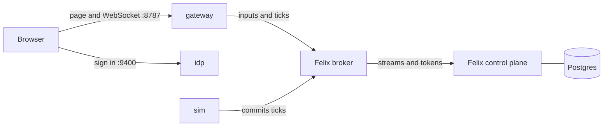

# Self-hosting Felix Arena

This guide runs the whole game on one machine: Felix, the simulation and the
page you play in. You need Docker or Podman and a few minutes. At the end you
and a friend are flying in the same arena.

It uses the released container images and one file, [`deploy/compose.yml`](../deploy/compose.yml).
You do not need to clone this repository, install Rust or Node, or build anything.

## What you need

- Docker with Compose v2 (`docker compose version` prints a version), or Podman
  with the `docker-compose` provider (see [Podman](#podman)).
- About 1 GB of free memory, 2 GB of free disk and two CPU cores.
- Free ports 8787 and 9400 on the machine.
- A browser with WebGL, such as a recent Chrome, Edge, Firefox or Safari.

The images are built for Intel/AMD and Arm (Apple silicon, Raspberry Pi 4 and later).

## Run it

```bash
mkdir felix-arena && cd felix-arena
curl -fsSLO https://raw.githubusercontent.com/GetFelix/felix-arena/main/deploy/compose.yml
docker compose up --detach
```

The first start pulls the images and takes a minute or two. Later starts take under half a minute. Check on it:

```bash
docker compose ps
```

When `gateway` and `sim` say `running`, open two browser windows:

- <http://127.0.0.1:8787/play.html?arena=alpha&as=ana>
- <http://127.0.0.1:8787/play.html?arena=alpha&as=ben>

Each window signs in as the name after `as=` and puts that player's craft in
arena `alpha`. Teams alternate as people join. W, A, S and D move, the
mouse aims, the left button fires and Space boosts. The match starts after a
ten-second warmup, even if you are alone.

To only watch, open `...&as=cleo`: `cleo` may watch but not play.

To stop everything and keep your data, run `docker compose stop`. `docker compose start` brings it back.

## What is running



| Service | What it does |
| --- | --- |
| `sim` | Runs each arena at 30 ticks a second and commits every tick to Felix. It is the only writer of ticks. |
| `broker` | Felix itself. Keeps every tick on disk and delivers them to the gateway. |
| `gateway` | Lets a browser use Felix over a WebSocket, and serves the game's page. A signed-in browser can read ticks and send its own inputs, and nothing else. |
| `controlplane`, `postgres` | Felix's record of the arenas and who may play. Postgres keeps it across restarts. |
| `idp` | A stand-in sign-in page. It lets anyone in who picks a name. |
| `seed` | Runs once at start to create the arenas and the tokens the broker and the sim use. |
| `tls` | Runs once to make the broker's certificate, so it stays the same across restarts. |

Only the gateway (port 8787) and the sign-in page (port 9400) are reachable from the host.

## Settings

Everything has a default. To change one, download [`deploy/.env.example`](../deploy/.env.example)
as `.env` next to `compose.yml`, edit it, and run `docker compose up --detach` again:

```bash
curl -fsSL https://raw.githubusercontent.com/GetFelix/felix-arena/main/deploy/.env.example -o .env
```

| Setting | Default | What it does |
| --- | --- | --- |
| `ARENA_VERSION` | `latest` | The release of the arena images to run. Set a version such as `0.2.0` to stay on it. |
| `ARENA_ARENAS` | `alpha bravo` | The arenas, separated by spaces. Each is its own match. |
| `ARENA_PLAYERS` | `ana,ben,dan,eve` | Who may play in every arena. |
| `ARENA_WATCHERS` | `cleo` | Who may only watch. |
| `SIM_MATCH_SECONDS` | `300` | How long a match lasts. |
| `SIM_KILL_LIMIT` | `25` | The kills that end a match early. |
| `SIM_WARMUP_SECONDS`, `SIM_RESULTS_SECONDS` | `10`, `15` | The pause before a match and after it. |
| `ARENA_BIND` | `127.0.0.1` | The host address the two ports listen on. |
| `ARENA_IDP_URL` | `http://127.0.0.1:9400` | The address a browser reaches the sign-in page at. |
| `POSTGRES_PASSWORD`, `ARENA_BOOTSTRAP_TOKEN` | `felix`, `arena-bootstrap` | Secrets that never leave the stack's own network. Change them if others share the machine. Set them before the first `up`. |
| `FELIX_VERSION` | the release this one was built for | The release of Felix's own images. |

The names in `ARENA_PLAYERS` and `ARENA_WATCHERS` are the names you pick at sign-in.
Changing them or the arenas needs the seed job to run again, which `up` does for you.

## Playing with other people

Browsers only allow the page's sign-in to run on `localhost` or on HTTPS. So
opening `http://192.168.1.20:8787` from another computer does not work, even
with `ARENA_BIND=0.0.0.0`.

If you run Felix Arena on a server, forward its two ports to your own machine over SSH, then play as above:

```bash
ssh -L 8787:127.0.0.1:8787 -L 9400:127.0.0.1:9400 you@your-server
```

Everyone who joins needs their own tunnel. For a game open to people who are not
on your machine or your server, serve both ports over HTTPS from a reverse proxy
that passes WebSocket upgrades, set `ARENA_IDP_URL` to the sign-in page's public
address, and open the game with `&idp=` and `&gateway=` set to the two public
addresses. The sign-in page lets in anyone who picks a name, so do not publish it
to people you do not trust. It is a stand-in for a real identity provider, which this setup does not wire up.

## Day to day

| To | Run |
| --- | --- |
| See what is running | `docker compose ps` |
| Watch the sim hold its tick rate | `docker compose logs -f sim` |
| Stop and start, keeping data | `docker compose stop`, then `docker compose start` |
| Remove the containers, keeping data | `docker compose down` |
| Wipe everything, matches included | `docker compose down --volumes` |

The sim prints a line every five seconds for each arena. A healthy one shows
`hz=30` and a `p99_ms` of a few milliseconds.

Every tick is on disk for seven days, which is how a kill cam and the replays
panel play earlier moments back. The data lives in Docker volumes: `broker` for
the ticks, `postgres` for the arenas and who may play, and `state` and `tls` for the
tokens and the certificate.

### Update

```bash
docker compose pull
docker compose up --detach
```

With `ARENA_VERSION` set, change it first. The arenas, who may play and the
recorded ticks stay.

### Renew the tokens

The broker and the sim sign in once, when they start, with tokens that last 30 days.
Before that, or after a long outage, make new ones and restart them:

```bash
docker compose run --rm seed
docker compose up --detach --force-recreate broker gateway sim
```

If the broker or the sim logs refused tokens, this is the fix too.

## Check the images

Every image is signed. The release's notes on GitHub list each image's digest. With
[cosign](https://docs.sigstore.dev/cosign/system_config/installation/) installed, check one:

```bash
cosign verify ghcr.io/getfelix/felix-arena-sim:latest \
  --certificate-identity-regexp '^https://github.com/GetFelix/felix-arena/' \
  --certificate-oidc-issuer https://token.actions.githubusercontent.com
```

## Podman

Everything above works with `podman compose` in place of `docker compose`, through the `docker-compose` provider
(version 2.20 or later):

```bash
export PODMAN_COMPOSE_PROVIDER=docker-compose
podman compose up --detach
```

On macOS, run `podman machine start` first. If every pull fails with an error
about a credential helper, Docker Desktop left a `credsStore` in
`~/.docker/config.json` that no longer exists. The images are public, so point
Compose at an empty config: `export DOCKER_CONFIG=$(mktemp -d)`.

## Troubleshooting

**A port is already in use.** Something else on the machine has 8787 or 9400.
Stop it, then run `docker compose up --detach` again.

**The page loads but sign-in or the game does not.** Open the page at
`127.0.0.1`, as above. The game looks for the sign-in page at
`http://127.0.0.1:9400` and the gateway at `127.0.0.1:8787` unless the address
sets `&idp=` and `&gateway=`.

**`seed` exits with an error.** Run `docker compose logs seed controlplane` to
see why. `docker compose up --detach` runs it again.

**Postgres logs `duplicate key value violates unique constraint`.** Every start
runs `seed` again, and it asks the control plane to create the namespace and
the streams that are already there. The control plane answers that it exists
and carries on, so the lines are noise and nothing needs fixing.

**The sim keeps restarting.** Run `docker compose logs sim`. A refused token
(see [Renew the tokens](#renew-the-tokens)) or a broker that is not up is the usual cause.

**You want to start over.** `docker compose down --volumes`, then `up` again.

## Build it yourself

To run a change you have made, build the images from a clone and point Compose at them:

```bash
git clone https://github.com/GetFelix/felix-arena && cd felix-arena
(cd web && npm ci && npm run core && npm run build)
for image in sim gateway seed idp; do
  docker build -f docker/$image.Dockerfile -t ghcr.io/getfelix/felix-arena-$image:local .
done
ARENA_VERSION=local docker compose -f deploy/compose.yml up --detach
```

`npm run core` needs the `wasm32-unknown-unknown` Rust target and `wasm-bindgen-cli`;
the [README](../README.md#development-stack) lists them. To work on the game itself, use the
[development stack](../README.md#development-stack) instead, which rebuilds as you go.
